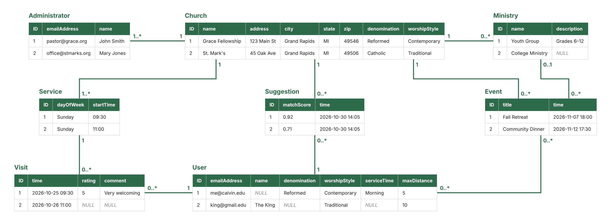

## Entities
Each entity maps directly to a database table. Sample rows are shown in the diagram.

| Entity | Attributes |
|---|---|
| User | ID, emailAddress, name, denomination, worshipStyle, serviceTime, maxDistance |
| Church | ID, name, address, city, state, zip, denomination, worshipStyle |
| Administrator | ID, emailAddress, name |
| Service | ID, dayOfWeek, startTime |
| Ministry | ID, name, description |
| Event | ID, title, time |
| Visit | ID, time, rating, comment |
| Suggestion | ID, matchScore, time |

## Entity Relationships
| Relationship | Multiplicity |
|---|---|
| Church — Administrator | 1 to 1..* |
| Church — Service | 1 to 1..* |
| Church — Ministry | 1 to 0..* |
| Church — Event | 1 to 0..* |
| Ministry — Event | 0..1 to 0..* (an Event may belong to no Ministry) |
| Church — Suggestion | 1 to 0..* |
| User — Suggestion | 1 to 0..* |
| User — Visit | 1 to 0..* |
| Service — Visit | 1 to 0..* |
| User — Event (attends) | 0..* to 0..* |

