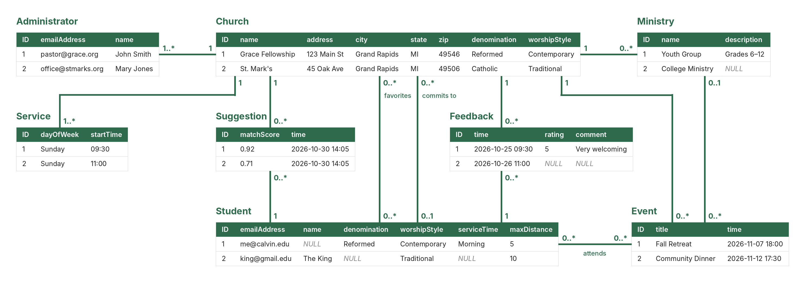

## Entities
Each entity maps to a database table, except where noted below. Sample rows are shown in the diagram.

| Entity | Attributes |
|---|---|
| Student | ID, emailAddress, name, denomination, worshipStyle, serviceTime, maxDistance |
| Church | ID, name, address, city, state, zip, denomination, worshipStyle |
| Administrator | ID, emailAddress, name |
| Service | ID, dayOfWeek, startTime |
| Ministry | ID, name, description |
| Event | ID, title, time |
| Feedback | ID, time, rating, comment |
| Suggestion | ID, matchScore, time |

Notes:
- **Student** is called User in earlier versions. The schema uses `studentId` throughout. The schema currently has only `student_preferences`, with no table holding email or name (see SCHEMA_HANDOFF.md).
- **Administrator** and **Event** are part of the model but have no tables in the schema yet. SCHEMA_HANDOFF.md lists the tables to add (`administrators`, `events`, `event_attendees`).
- **Favorites** and **Commitment** are relationships, not entities. They are implemented as the `favorites` and `commitments` tables.

## Entity Relationships
| Relationship | Multiplicity |
|---|---|
| Church — Administrator | 1 to 1..* |
| Church — Service | 1 to 1..* |
| Church — Ministry | 1 to 0..* |
| Church — Event | 1 to 0..* |
| Ministry — Event | 0..1 to 0..* (an Event may belong to no Ministry) |
| Church — Suggestion | 1 to 0..* |
| Student — Suggestion | 1 to 0..* |
| Church — Feedback | 1 to 0..* |
| Student — Feedback | 1 to 0..* |
| Student — Church (favorites) | 0..* to 0..* |
| Student — Church (commits to) | 0..1 to 0..* (a student commits to at most one church) |
| Student — Event (attends) | 0..* to 0..* |

